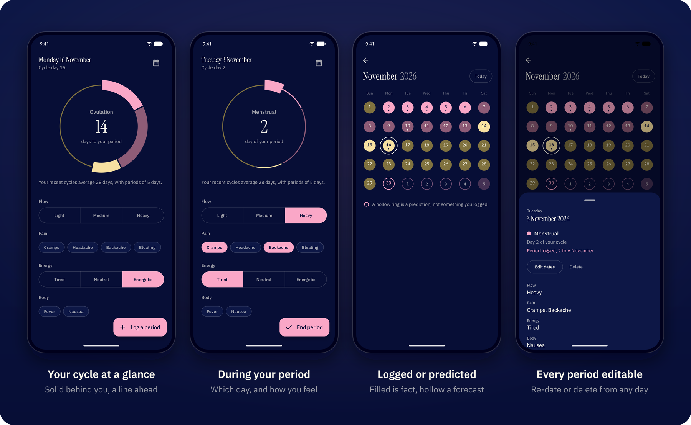
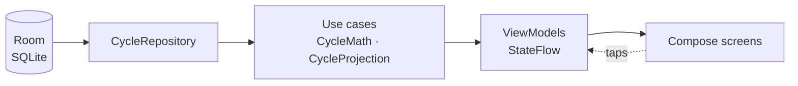

<p align="center">
  
</p>

<h1 align="center">Luna</h1>

<p align="center">
  <strong>A period tracker that never leaves your phone.</strong><br>
  No internet permission, no account, no analytics. Your cycle stays on your device.
</p>

<p align="center">
  <a href="https://github.com/ahadullabaig/Luna/releases/latest"></a>
  <a href="LICENSE"></a>
  <a href="#install"></a>
  <a href="#privacy"></a>
  <a href="#tech-stack"></a>
</p>

<p align="center">
  <a href="https://github.com/ahadullabaig/Luna/releases/latest"><strong>Download the APK</strong></a>
  &nbsp;·&nbsp; <a href="#install">Install</a>
  &nbsp;·&nbsp; <a href="#privacy">Privacy</a>
  &nbsp;·&nbsp; <a href="#build-from-source">Build from source</a>
</p>

<br>

<p align="center">
  
</p>

## Why Luna

Cycle data says more about you than almost anything else on your phone. It can hint at a pregnancy, a health condition, or a decision you haven't told anyone about. Most period apps keep that data on their servers, and some have shared it with advertisers and analytics firms.

Luna takes the opposite approach. It has no server, no account, and no permission to use the internet. Everything you log is written to a database on your phone, and that is the only place it ever exists. The only data that can't leak is data that was never collected.

## Features

- **See where you are at a glance.** The home screen is a ring of your whole cycle, one colour per phase. Days you've lived are drawn solid, days still ahead as a thin line, and the point where one becomes the other is today.
- **Get the number that matters right now.** Most of the time the centre of the ring counts down to your next period. During a period it shows which day you're on. If you're late it says so in pink, for example "5 days late".
- **Predictions based on your own cycles.** Luna uses the median of your last six cycles, not a textbook 28 days. The luteal phase is held at about 14 days and the follicular phase absorbs the variation, which keeps predictions accurate for longer and shorter cycles. Until it has enough history, it tells you it's estimating.
- **Log symptoms in one tap.** Record flow, pain, energy and body symptoms for today. Each tap saves immediately, and tapping again undoes it. There's no Save button.
- **Logged days and guesses never look alike.** In the calendar, a period day you logged is a filled circle and one Luna expects is a hollow ring. The home ring follows the same rule, so you can always tell what's recorded from what's predicted.
- **Fix any period.** While a period is ongoing, the main button becomes **End period**. Tap any logged day in the calendar to change its dates or delete it. Luna won't let two periods overlap.
- **Late periods handled honestly.** A late period keeps the current cycle open rather than quietly starting a new one. The next expected start moves forward a day at a time until you log it.

## Privacy

| What Luna stores | Where it's kept |
|---|---|
| Period start and end dates | A database on your phone |
| Daily symptoms (flow, pain, energy, body) | A database on your phone |

That's all it stores. There are no identifiers, no usage statistics and no crash reports.

- **No internet permission.** Without it, Android refuses to let the app open a network connection. The release APK's only permission is one that AndroidX defines for Luna's own use, to keep its internal broadcasts private. It gives Luna no access to anything.
- **No backups, cloud or device-to-device.** `allowBackup="false"` turns off Google's cloud backup. Android 12 added a separate device-to-device transfer that ignores that flag, so [`data_extraction_rules.xml`](app/src/main/res/xml/data_extraction_rules.xml) excludes every data domain from both.
- **Fonts are bundled.** Instrument Serif and IBM Plex Sans ship inside the APK. Loading them through Android's downloadable-fonts service would have meant a network call through Google Play Services.
- **No account.** There's no profile to request or delete. Uninstalling the app removes everything.

> [!IMPORTANT]
> The trade-off is real. Luna has no backup, export or sync. If you uninstall it or lose your phone, your history is gone, and it won't transfer to a new phone.

You can check the permissions yourself with the Android SDK's build tools:

```bash
aapt2 dump permissions Luna-2.0.apk
# package: com.luna.app
# permission: com.luna.app.DYNAMIC_RECEIVER_NOT_EXPORTED_PERMISSION
# uses-permission: name='com.luna.app.DYNAMIC_RECEIVER_NOT_EXPORTED_PERMISSION'
```

## Install

Luna needs **Android 8.0 or newer**. It isn't on the Play Store, so you install the APK directly.

1. Download `Luna-2.0.apk` from the [latest release](https://github.com/ahadullabaig/Luna/releases/latest) on your phone.
2. Open the file. The first time, Android asks you to allow installs from the app you opened it with, such as Chrome or Files.
3. Tap **Install**. If Play Protect warns that it doesn't recognise the app, choose **More details → Install anyway**. It shows this for any app that isn't on the Play Store.

**Updating:** install the new APK over the existing one and your data stays. Never uninstall Luna to update it, because that deletes your history.

<details>
<summary><strong>Verify the download</strong></summary>

<br>

Each release lists the APK's SHA-256 checksum. Every Luna release is signed with the same certificate:

```bash
sha256sum Luna-2.0.apk
apksigner verify --print-certs Luna-2.0.apk
# V2 Signer: certificate DN: CN=Luna
# V2 Signer: certificate SHA-256 digest: 556501dabf85fca5c4f4715b925d265898df2ff30f14bd90f2445f1b65a9f6bc
```

If the certificate digest is different, the file wasn't built by this project. Don't install it.

</details>

## Build from source

You need JDK 21 and the Android SDK with platform 35. Android Studio includes both.

```bash
git clone https://github.com/ahadullabaig/Luna.git
cd Luna
./gradlew installDebug        # build and install on a connected device or emulator
```

To build a signed, minified release APK (about 1.8 MB, against 11 MB for debug), create a signing key once:

```bash
keytool -genkeypair -v -keystore luna-release.jks -alias luna \
  -keyalg RSA -keysize 2048 -validity 10000 -dname "CN=Luna"
```

Then add `keystore.properties` at the repository root. It's gitignored, like the keystore:

```properties
storeFile=luna-release.jks
storePassword=your_password
keyAlias=luna
keyPassword=your_password
```

```bash
./gradlew assembleRelease
# app/build/outputs/apk/release/app-release.apk
```

If the output is named `app-release-unsigned.apk`, Gradle didn't find `keystore.properties`. A fresh clone builds unsigned rather than failing.

> [!WARNING]
> Back the keystore up somewhere outside the repository. Android only installs an update signed with the same key as the installed copy. If you lose the key, the only way to install a new build is to uninstall first, which deletes the data.

## How it works

Luna is a single-module app built with MVVM. Data flows one way, from the database up to the screen:



The cycle logic is plain Kotlin functions over plain lists, with no Room, Android or mocks involved, so it's unit-tested directly. Phases are counted from the start of each period. Ovulation day is `cycleLength − 14`:

| Phase | Days |
|---|---|
| Menstrual | 1 to period length |
| Follicular | the day after the period, to 2 days before ovulation |
| Ovulation | a 3-day window centred on ovulation day |
| Luteal | the rest of the cycle |

Cycle length is the median gap between your last six period starts. Period length is the median length of your last six completed periods. Until it has two cycles to measure, Luna uses 28 and 5 days and says so on the home screen.

### Tech stack

| Layer | Choice |
|---|---|
| Language | Kotlin 2.2 |
| UI | Jetpack Compose, Material 3 |
| Architecture | MVVM, `StateFlow`, unidirectional data flow |
| Storage | Room 2.7 (SQLite), schema exported and versioned |
| Dependency injection | Hilt |
| Navigation | Navigation Compose 2.9, type-safe `@Serializable` routes |
| Dates | kotlinx-datetime |
| Calendar grid | [kizitonwose/Calendar](https://github.com/kizitonwose/Calendar) |
| Build | AGP 9.4, Gradle 9.6, JDK 21 toolchain, R8 |

### Project layout

```
app/src/main/java/com/luna/app/
├── data/          Room database, DAOs, entities, CycleRepository
├── domain/
│   ├── model/     CyclePhase, CycleState, symptoms
│   └── usecase/   cycle maths and projection (pure Kotlin)
├── feature/
│   ├── home/      ring, symptom logging
│   └── calendar/  month grid, day details
├── ui/            theme, navigation, shared period dialog
└── di/            Hilt module
```

### Tests

```bash
./gradlew test    # 58 unit tests
./gradlew lint
```

The tests cover every phase boundary day by day, the medians, short cycles that skip a phase entirely, late periods, and the overlap guard.

## Not included, on purpose

Luna has no notifications, widgets, export, cloud sync, multiple profiles or "AI insights". Some of these would break the privacy guarantee. The rest would add things to maintain to an app run by one person, and every feature is something that can break.

## License

Luna is free software, released under the [GNU General Public License v3.0](LICENSE). You can use, study, change and share it. If you distribute a modified version, it must also be under the GPL with its source available, so nobody can ship a closed copy of Luna with trackers added.
